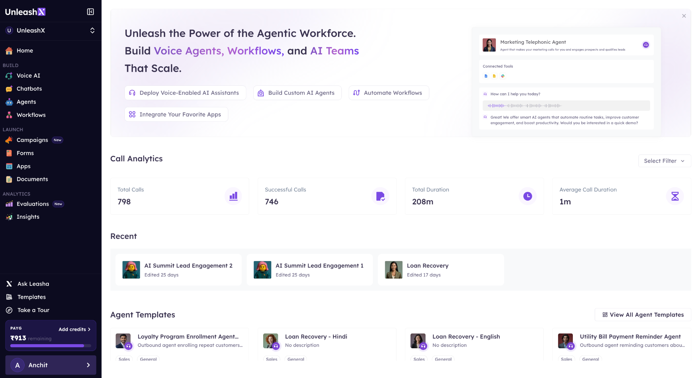
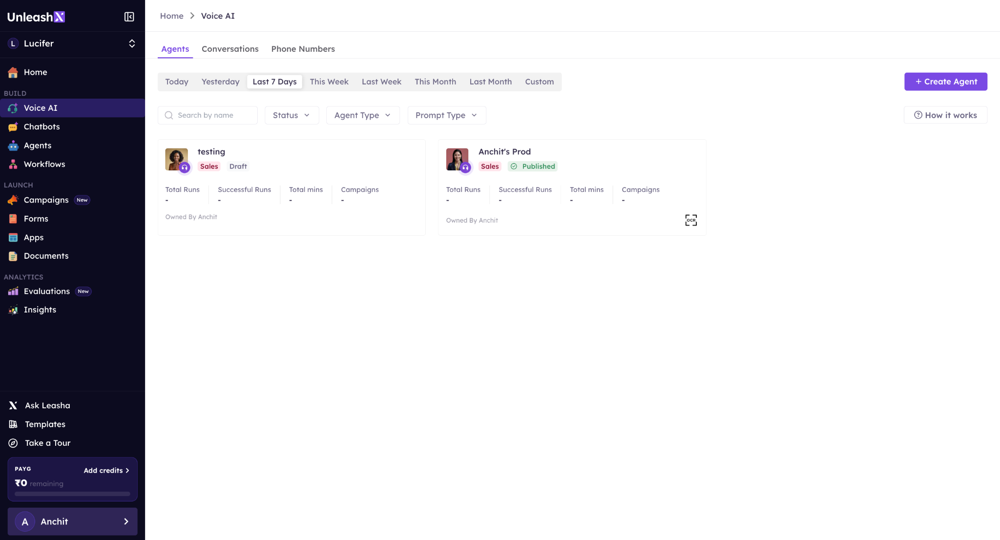
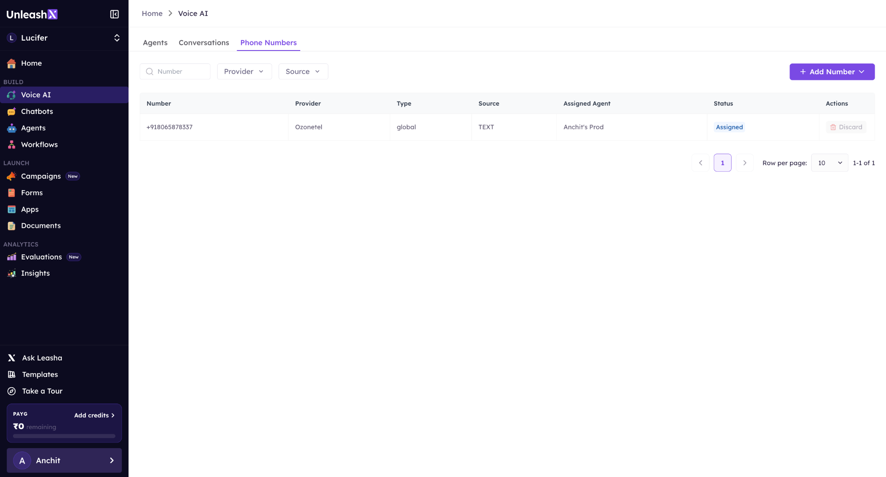
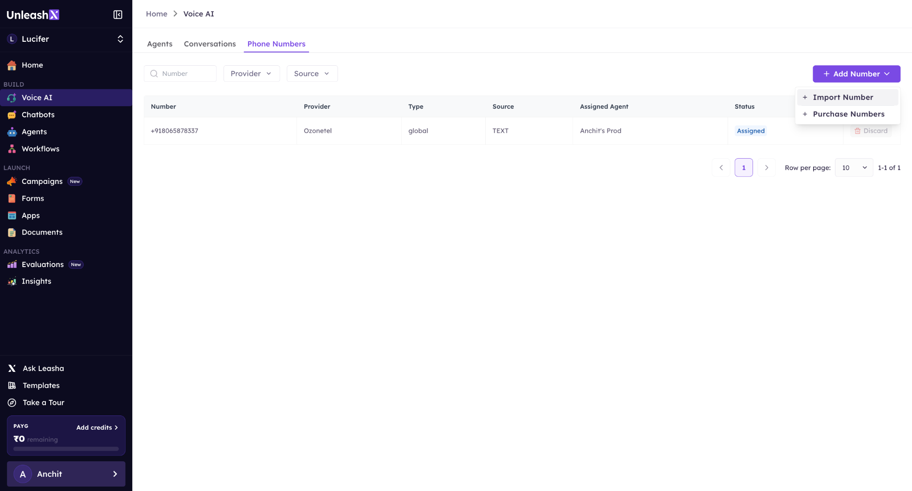
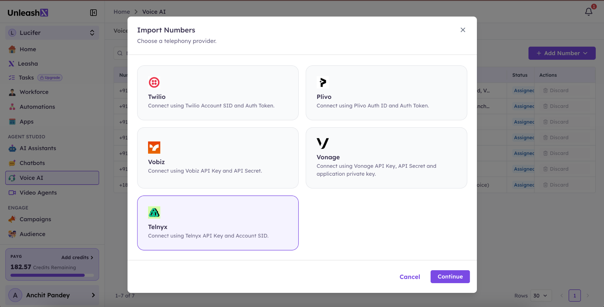
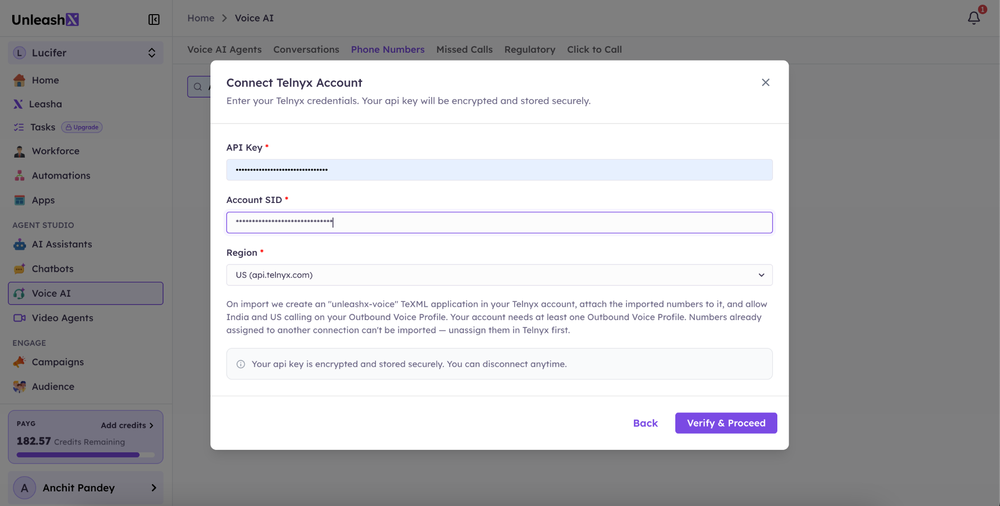

# Integrate Telnyx with UnleashX for Smarter Voice Automation

Connect Telnyx with UnleashX to run voice workflows on a fast, carrier-grade network. Manage inbound and outbound calls while keeping full control of your telephony setup. Link your Telnyx account in a few steps and start building highly customizable calling experiences.

---

## What does Telnyx integration mean in UnleashX?

Telnyx is a global communications platform that runs its own private IP network, and UnleashX fully supports it. With the Telnyx integration, you can:

- Place outbound calls with intelligent AI agents
- Answer inbound calls with automated, real-time responses
- Use your own Telnyx account, so you keep full ownership of your numbers and infrastructure

You get flexibility, scale and control, without being locked into one provider.

---

## Getting Started with Telnyx in UnleashX

**Make outbound calls**
Let UnleashX agents place calls from your Telnyx numbers.

**Handle incoming calls**
Route calls on your Telnyx numbers to UnleashX agents, which answer right away.

**Connect your Telnyx account**
Link your existing Telnyx account and start managing calls through UnleashX.

---

## Why Use Telnyx with UnleashX?

**Private Global Network**
Calls run over Telnyx's own private backbone for low latency and clear audio.

**Carrier-Grade Reliability**
Count on a licensed carrier built for high uptime and high call volumes.

**Real-Time Call Control**
Transfer or end calls right from your AI workflows.

**Cost-Effective Scaling**
Grow your call volume with transparent, usage-based pricing.

---

## Securely Connect Your Telnyx Account to UnleashX

Linking your Telnyx account with UnleashX is quick and secure. Once connected, you can import your phone numbers and assign them to AI agents for both inbound and outbound calling.

### Step-by-Step Setup

<Steps>
  <Step title="Log in">
    Sign in to your UnleashX account.

    <Frame>
      
    </Frame>
  </Step>
  <Step title="Navigate to Voice AI">
    From the sidebar, open the **Voice AI** section.

    <Frame>
      
    </Frame>
  </Step>
  <Step title="Open Phone Numbers">
    Go to the **Phone Numbers** tab from the top navigation bar.

    <Frame>
      
    </Frame>
  </Step>
  <Step title="Add a Number">
    Click on **Add Number** and choose **Import Number**.

    <Frame>
      
    </Frame>
  </Step>
  <Step title="Select Telnyx">
    Pick **Telnyx** from the available options and click **Continue**.

    <Frame>
      
    </Frame>
  </Step>
  <Step title="Verify Credentials">
    Enter your **API Key** and **Account SID**, choose your **Region**, then click **Verify & Proceed**.

    <Frame>
      
    </Frame>
  </Step>
  <Step title="Import Number">
    Select the phone number you want to import and click **Import**. UnleashX creates an app in your Telnyx account and attaches the selected number to it.

    <Warning>
      A number that is already attached to another app in Telnyx can't be imported, and the import fails with an error. Unassign it in Telnyx first.
    </Warning>
  </Step>
  <Step title="Assign to Agent">
    Go to any agent, open the **Edit Agent** section, and select the imported number. Your agent is now ready to handle calls using that number.
  </Step>
</Steps>
