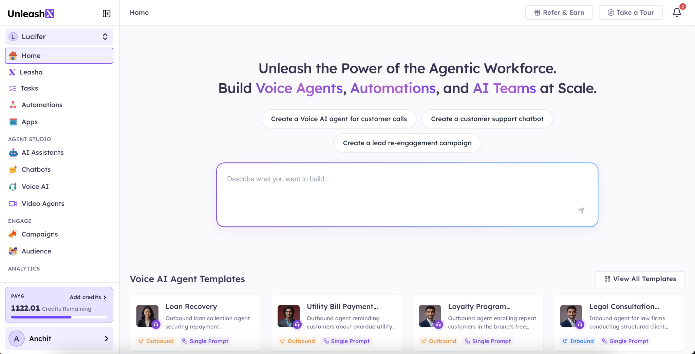
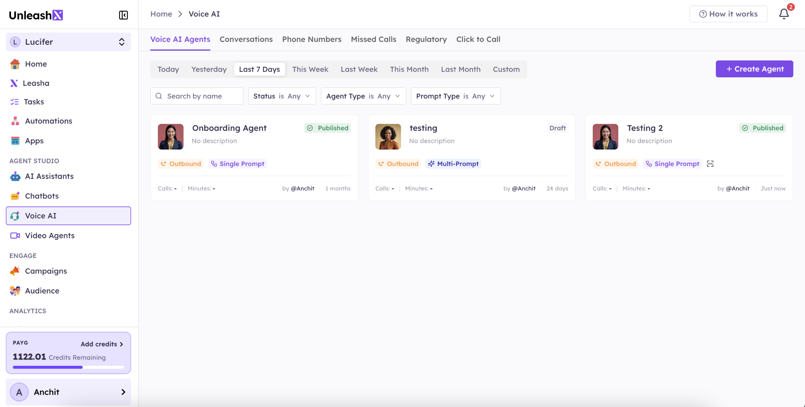
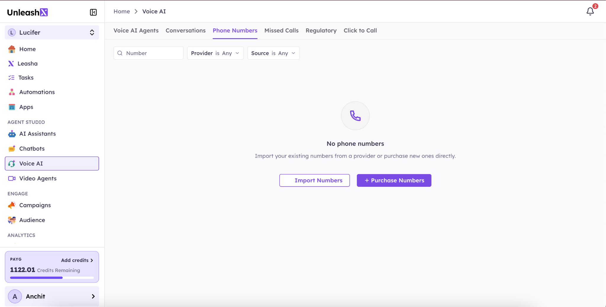
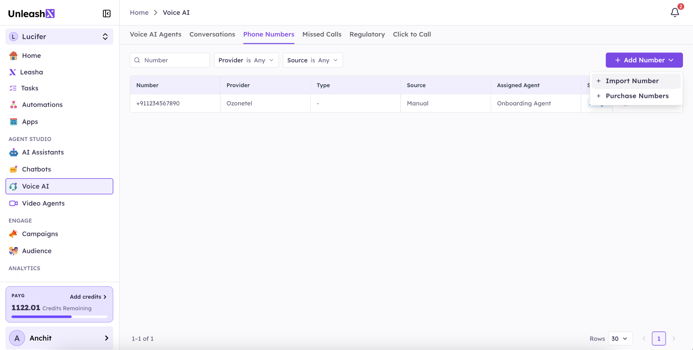
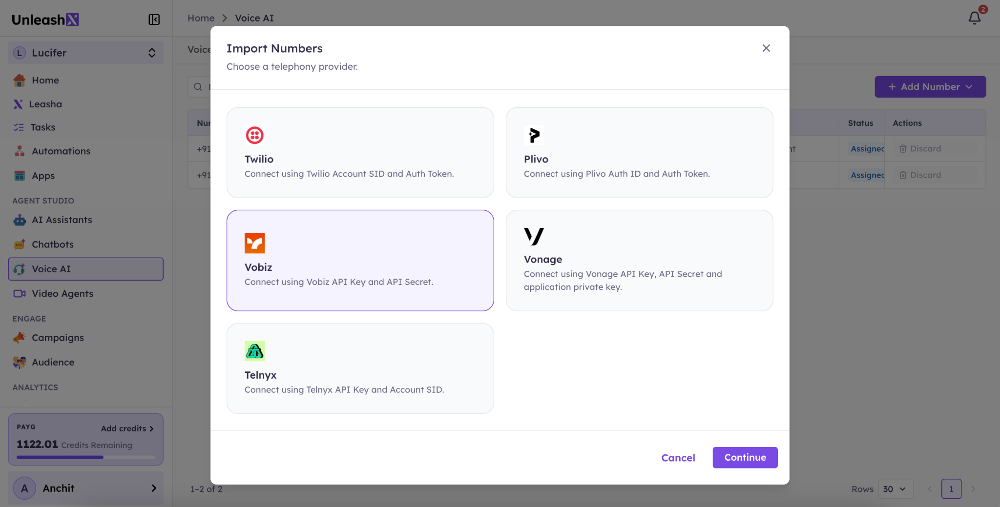
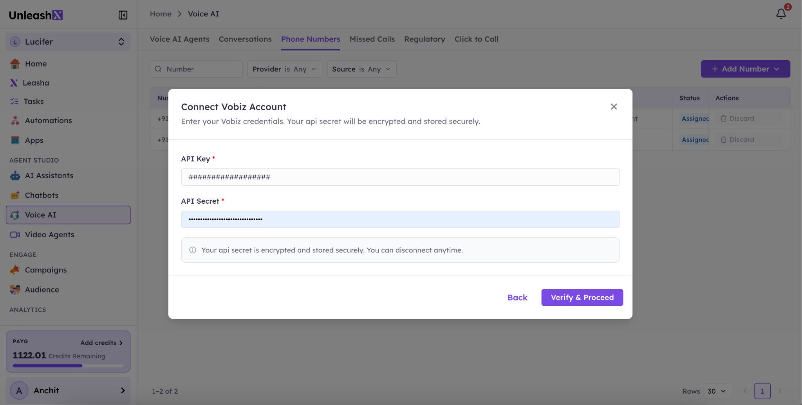

# Integrate Vobiz with UnleashX for Smarter Voice Automation

Enhance your voice workflows by connecting Vobiz with UnleashX. Seamlessly manage inbound and outbound calls while maintaining full control over your telephony setup. Follow a simple setup process to link your Vobiz account and unlock highly customizable calling experiences.

---

## What does Vobiz integration mean in UnleashX?

Vobiz is a cloud communications platform, fully supported within UnleashX. By integrating Vobiz, you can:

- Initiate outbound calls using intelligent AI agents
- Handle inbound calls with automated, real-time responses
- Use your own Vobiz account for complete ownership of numbers and infrastructure

This integration gives you flexibility, scalability, and control — without being locked into a single provider.

---

## Getting Started with Vobiz in UnleashX

**Make outbound calls**
Deploy UnleashX agents to place calls using your Vobiz numbers.

**Handle incoming calls**
Receive calls on your Vobiz numbers and let UnleashX agents respond instantly.

**Connect your Vobiz account**
Easily link your existing Vobiz account to start managing calls through UnleashX.

---

## Why Use Vobiz with UnleashX?

**High Reliability**
Count on stable connections and clear, high-quality audio.

**Full Flexibility**
Continue using your existing Vobiz setup without disruption.

**Advanced Capabilities**
Leverage Vobiz's rich feature set alongside UnleashX's AI-driven automation.

---

## Securely Connect Your Vobiz Account to UnleashX

Linking your Vobiz account with UnleashX is quick and secure. Once connected, you can import your phone numbers and assign them to AI agents for both inbound and outbound calling.

### Step-by-Step Setup

<Steps>
  <Step title="Log in">
    Sign in to your UnleashX account.

    <Frame>
      
    </Frame>
  </Step>
  <Step title="Navigate to Voice AI">
    From the sidebar, open the **Voice AI** section.

    <Frame>
      
    </Frame>
  </Step>
  <Step title="Open Phone Numbers">
    Go to the **Phone Numbers** tab from the top navigation bar.

    <Frame>
      
    </Frame>
  </Step>
  <Step title="Add a Number">
    Click on **Add Number** and choose **Import Number**.

    <Frame>
      
    </Frame>
  </Step>
  <Step title="Select Vobiz">
    Pick **Vobiz** from the available options and click **Continue**.

    <Frame>
      
    </Frame>
  </Step>
  <Step title="Verify Credentials">
    Enter your **API Key** and **API Secret**, then click **Verify & Proceed**.

    <Frame>
      
    </Frame>
  </Step>
  <Step title="Import Number">
    Select the phone number you want to import and click **Import**.
  </Step>
  <Step title="Assign to Agent">
    Go to any agent, open the **Edit Agent** section, and select the imported number. Your agent is now ready to handle calls using that number.
  </Step>
</Steps>
