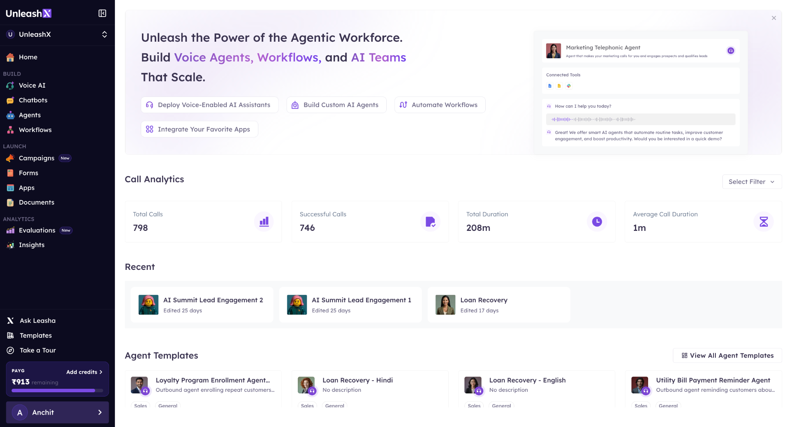
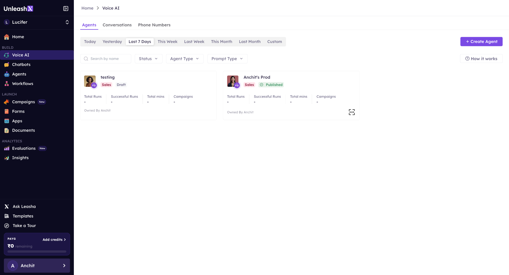
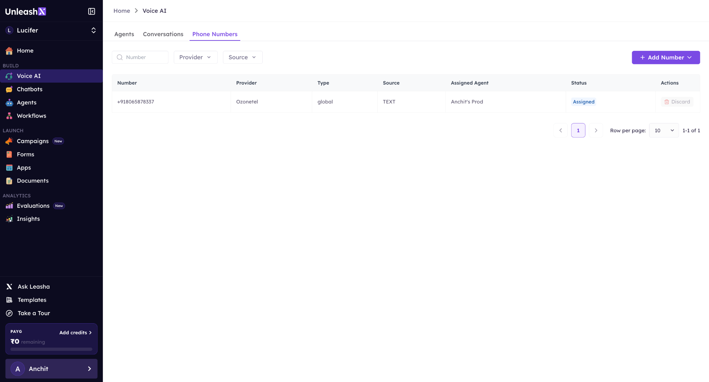
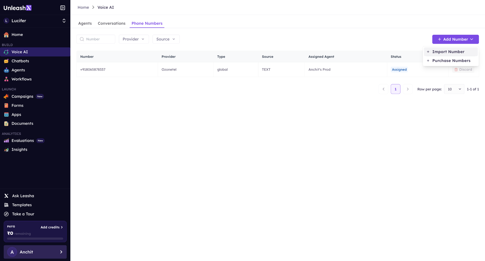
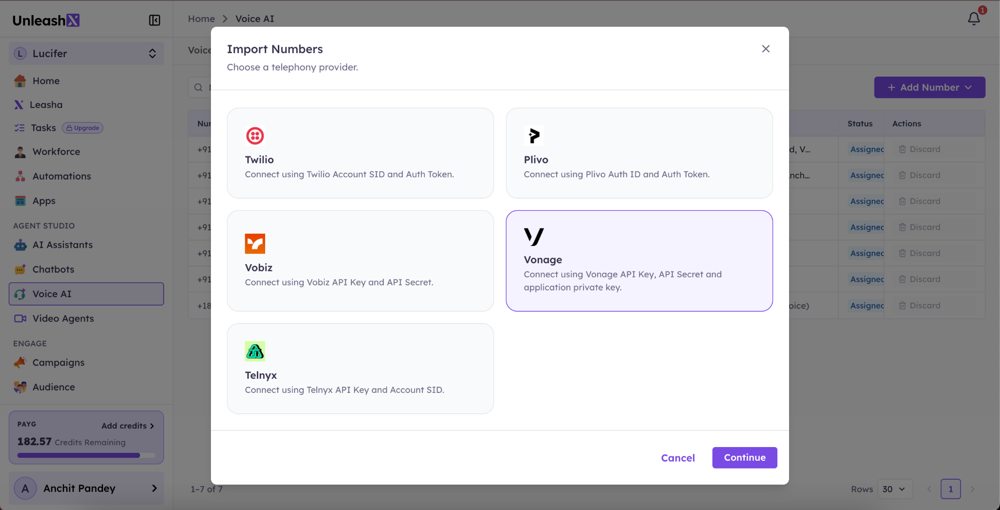
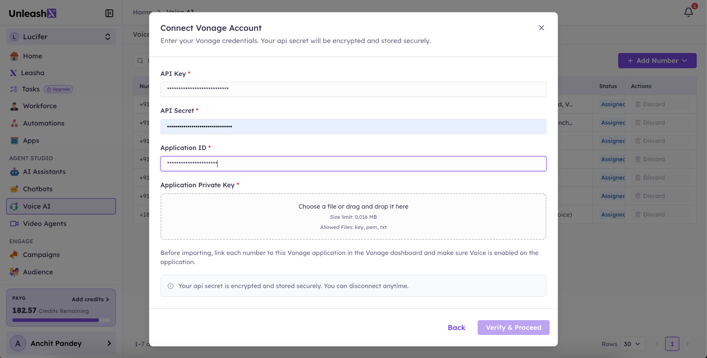

# Integrate Vonage with UnleashX for Smarter Voice Automation

Connect Vonage with UnleashX to power your voice workflows. Manage inbound and outbound calls while keeping full control of your telephony setup. Link your Vonage account in a few steps and start building flexible, AI-powered calling experiences.

---

## What does Vonage integration mean in UnleashX?

Vonage is a global cloud communications platform, and UnleashX fully supports it. With the Vonage integration, you can:

- Place outbound calls with intelligent AI agents
- Answer inbound calls with automated, real-time responses
- Use your own Vonage account, so you keep full ownership of your numbers and infrastructure

You get flexibility, scale and control, without being locked into one provider.

---

## Getting Started with Vonage in UnleashX

**Make outbound calls**
Let UnleashX agents place calls from your Vonage numbers.

**Handle incoming calls**
Route calls on your Vonage numbers to UnleashX agents, which answer right away.

**Connect your Vonage account**
Link your existing Vonage application and start managing calls through UnleashX.

---

## Why Use Vonage with UnleashX?

**Global Coverage**
Reach customers worldwide through Vonage's international network.

**Enterprise-Grade Reliability**
Count on stable connections and clear, high-quality audio.

**Seamless Call Control**
Transfer calls to live agents or end them right from your AI workflows.

**Keep Your Existing Setup**
Keep your current Vonage numbers and configuration as they are.

---

## Securely Connect Your Vonage Account to UnleashX

Linking your Vonage account with UnleashX is quick and secure. Once connected, you can import your phone numbers and assign them to AI agents for both inbound and outbound calling.

### Step-by-Step Setup

<Steps>
  <Step title="Log in">
    Sign in to your UnleashX account.

    <Frame>
      
    </Frame>
  </Step>
  <Step title="Navigate to Voice AI">
    From the sidebar, open the **Voice AI** section.

    <Frame>
      
    </Frame>
  </Step>
  <Step title="Open Phone Numbers">
    Go to the **Phone Numbers** tab from the top navigation bar.

    <Frame>
      
    </Frame>
  </Step>
  <Step title="Add a Number">
    Click on **Add Number** and choose **Import Number**.

    <Frame>
      
    </Frame>
  </Step>
  <Step title="Select Vonage">
    Pick **Vonage** from the available options and click **Continue**.

    <Frame>
      
    </Frame>
  </Step>
  <Step title="Verify Credentials">
    Enter your **API Key**, **API Secret** and **Application ID**, upload your **Application Private Key** file, then click **Verify & Proceed**.

    <Note>
      Before importing, link each number to this Vonage application in the Vonage dashboard and make sure Voice is enabled on the application.
    </Note>

    <Frame>
      
    </Frame>
  </Step>
  <Step title="Import Number">
    Select the phone number you want to import and click **Import**.
  </Step>
  <Step title="Assign to Agent">
    Go to any agent, open the **Edit Agent** section, and select the imported number. Your agent is now ready to handle calls using that number.
  </Step>
</Steps>
